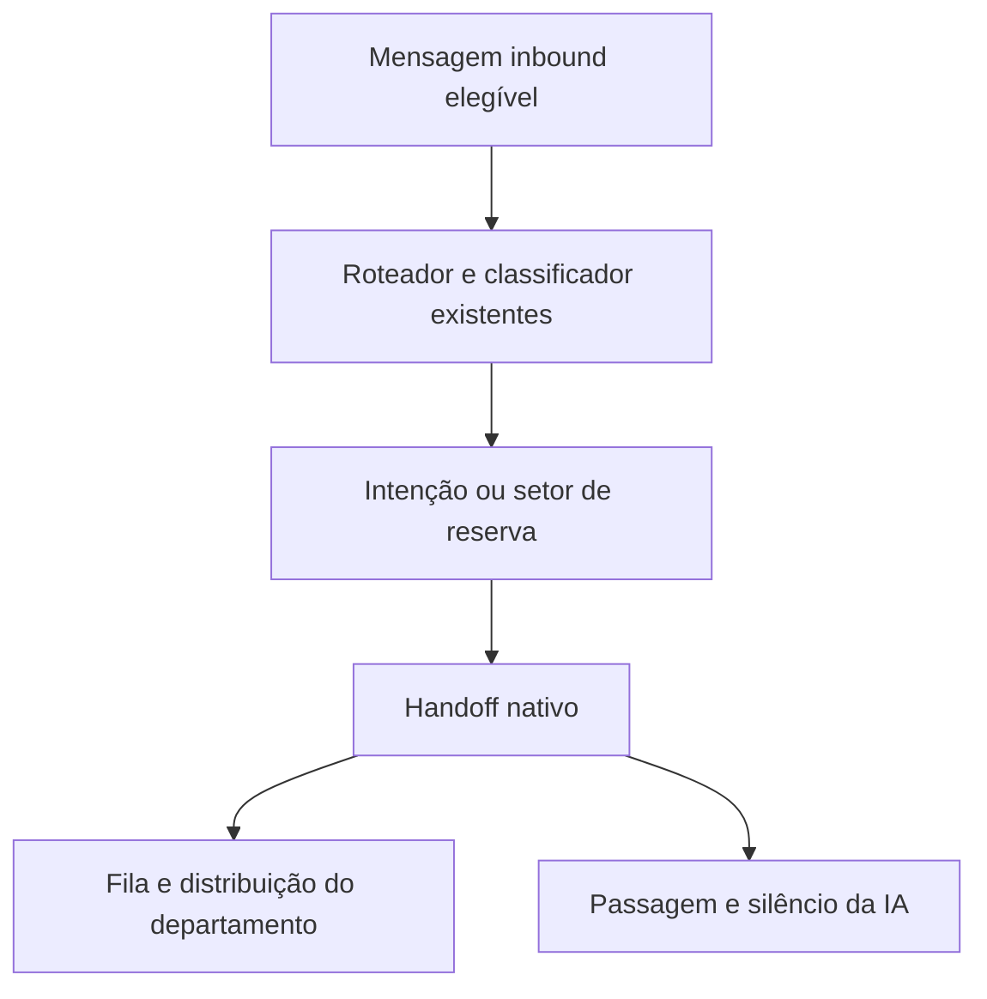

# Roteador para setores humanos

O roteador existente ganha um destino opcional em `ai_routers.config.human_routing`.
Sem esse campo, mantém o modo de agentes e a precedência das campanhas.

- Entrada: o dreno reconhece o setor de reserva ativo como capacidade de atendimento,
  mesmo sem agente de IA publicado. Os gates de organização, canal, grupo,
  elegibilidade e atendimento humano permanecem.
- Configuração: Roteadores → editor → Setores humanos. O PATCH valida IDs ativos da
  própria organização. O teste aceita roteador humano inativo, sem transferir ou
  enviar mensagens. A criação inicia o roteador e a configuração humana é salva no editor.
- Execução: o resolvedor devolve `destinationDepartmentId`; o turno chama
  `handoffRouterDepartment` antes da janela de envio. Revalida o setor e usa
  `applyRequestHumanHandoff` e `fn_agent_handoff_department` (migration 9007).
- Saída: fila do departamento, evento `conversation.department_routing_requested`,
  distribuição já existente, passagem com origem `runtime_nativo`, `force_human`,
  silêncio infinito e cancelamento dos crons. Nenhuma resposta automática ou tool
  de funil é executada nesse ramo.
- Falhas: intenção desconhecida, baixa confiança e classificador indisponível usam
  o setor de reserva. Política malformada ou setor indisponível falham sem executar
  o bot genérico. O job mantém o mecanismo de tentativas/aviso operacional existente.
- Retorno: o atendente pode transferir pelo Inbox; o administrador corrige descrições,
  exemplos ou destinos no mesmo editor e testa antes de reativar. As próximas
  classificações leem a configuração atual, sem cache de processo.
- Limite: campanha com agente publicado continua tendo precedência sobre o roteador.
  A transferência não remove o silêncio de uma conversa já entregue a humanos.

Provas: resolvedor e loader unitários, operação nativa com invariantes de banco,
`roteador-transfere-sem-conversar.test.ts`, API com isolamento de organização e
`roteador-setores-humanos.spec.ts` para salvar/recarregar/testar inativo, trocar os dois setores e ativar/desativar com persistência conferida no banco. Evidências em `evidence/roteador-setores-humanos/README.md`.
