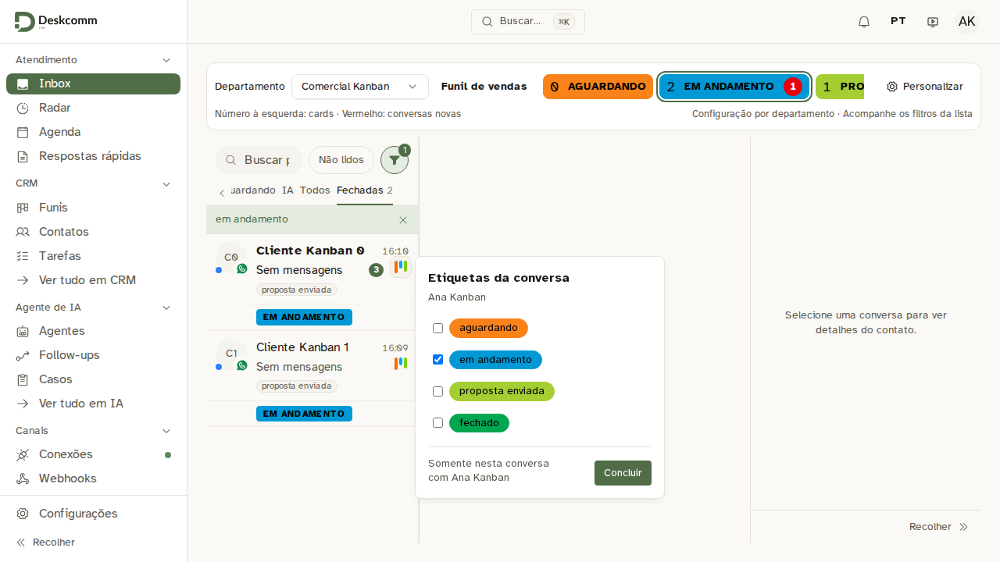
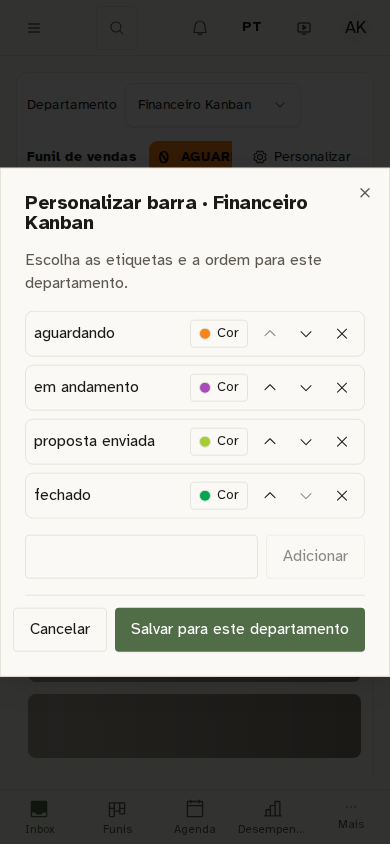
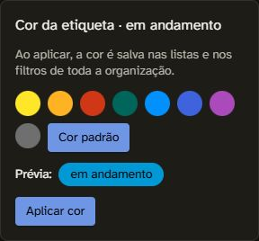

# Etiquetas destacadas no Inbox

Correção do PR [#42](https://github.com/Edsonl10/DeskcommCRM/pull/42), instalada na revisão `75ddd985fd9e7c31559d9561f71553101caa6ee4`. A barra e a faixa usam as etiquetas existentes da conversa. Cores são compartilhadas com o vocabulário atual, sem alteração de banco ou novas consultas por conversa.

Fonte validada: `100f3872f9827f763ab2794d65489d1e4fefaa50`. Árvore integralmente idêntica à instalação: `e0f7964847b214d5e889a096ef09abc0ffab1e46`. Os cinco gates passaram: [CI/banco](https://github.com/Edsonl10/DeskcommCRM/actions/runs/40906151415), [seis partes E2E](https://github.com/Edsonl10/DeskcommCRM/actions/runs/40906151388), [build](https://github.com/Edsonl10/DeskcommCRM/actions/runs/40906151386) e [imagens](https://github.com/Edsonl10/DeskcommCRM/actions/runs/40906151443). A jornada Kanban passou em 14,7 s; parte 6 com 62 casos aprovados. [Publicação](https://github.com/Edsonl10/DeskcommCRM/actions/runs/40910561408) aprovada, com oito builds, sondas AMD64/ARM64 e manifestos. Runs repetidos ci/perf/e2e do merge cancelados após conferir igualdade integral das árvores.

## Resultado e conferência

- Etiquetas em faixa abaixo da prévia, usando as mesmas cores da barra. Todos os rótulos da conversa aparecem; os selos do contato continuam separados.
- Aviso vermelho somente quando há novas conversas. Total continua visível quando o aviso some.
- Personalizar oferece Cor, paleta, prévia e Aplicar cor. Essa ação salva a cor compartilhada na organização; a janela fica modal durante a aplicação. Cor padrão recupera a cor inicial da etapa.
- Funil ao lado de Não lidos, no lugar de Grupos; sem dropdown Todas as tags. Grupos e etiquetas gerais continuam no painel avançado.
- Produção: lista e contadores carregaram; faixa medida abaixo da prévia; avisos zero ausentes; funil alinhado à busca. Seletor de cor e filtros avançados abertos e fechados sem salvar. Busca vazia, janelas fechadas e prévia deixada disponível. Nenhuma conversa aberta para esta prova; nenhuma etiqueta/cor gravada nem mensagem enviada. A aba de trabalho original foi preservada.
- App, worker e scheduler running/healthy, revisão `75ddd98`, por digest. Saúde healthy; HTTP `/` 200 e `/app` 307. Backup validado e retorno preparado com as imagens anteriores reais. Caddy e demais serviços preservados; sem SQL. Voice-agent publicado pelo workflow e não instalado.

## Capturas

Capturas do banco fresco do CI, com dados sintéticos:

Seletor publicado, recortado para não incluir clientes; aberto somente para consulta:

## Limites e rastreio

A persistência de cor/etiquetas, recarga e configuração por departamento foram medidas no E2E sintético. Os demais computadores físicos não foram acessados. Não houve novo ensaio de carga: a política de leitura corrigida e os contratos das contagens permanecem os mesmos.

Local: typecheck e verificações direcionadas aprovados. O controle negativo do aviso produziu exatamente uma falha e três aprovações; restaurar a guarda aprovou os quatro casos. A suíte integral local foi interrompida e o lint integral local terminou por limite de memória; não foram declarados verdes localmente. Banco/build/E2E integrais são a prova do CI nativo.

Digests, gates, recibo sanitizado, hashes das capturas e scripts operacionais: [resultado.json](resultado.json). Backup/recibo privado: `/opt/backups/crm-inbox-etiquetas-20261029-75ddd98/recibo-roteador.json`. Contrato: [barra de etiquetas](../../docs/features/inbox-kanban.md).
