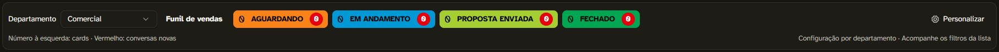

# Inbox: barra Kanban por departamento

Capturas do cenário sintético `tests/e2e/inbox-kanban.spec.ts`, aprovado na parte 6 do E2E 40782196502, fonte `d45870dccb5329e2f1681cd181d77982ef2b8273`. Artefato original: `evidencia-parte-6`, id 12858448234. Organização, clientes e atendentes são fixtures de teste.

- `etiquetas-sinteticas.png`: filtro, contagem de cards e conversas novas e seleção múltipla pelo ícone abaixo da hora.
- `configuracao-celular.png`: configuração por departamento em 390 × 844 px, com os botões de salvar/cancelar visíveis.

A fonte final `e4629935145b399e1ed91dd80af21a09a3dc663d` passou nos cinco gates, incluindo seis partes E2E (40857592527), PG15/PG17 e atualização sobre dados existentes. A espera da medição ao recolher a ficha mantém o piso >200 px; o cenário passou em 9,4 s. Os componentes e estilos destas capturas sintéticas permanecem os mesmos.

A integração `98d6c51e567560c394ac7fa6979a3ef193cb3c24` foi instalada em 29/10/2026 após a publicação 40861407459, com árvore integralmente idêntica à fonte aprovada. App, worker e scheduler estão saudáveis. Backup validado, migration transacional 9008 aplicada, Caddyfile e demais serviços preservados. Os runs duplicados de ci/perf/e2e no push foram cancelados depois da conferência da árvore; a fonte conserva os cinco gates aprovados.

`publicado.jpg` mostra exclusivamente a barra na produção, com busca de validação sem resultados. Na instalação real também foram abertos o seletor de etiquetas e as janelas de Personalizar padrão/Comercial, canceladas após conferir. A seleção voltou a Todos os departamentos e a busca foi limpa. As gravações e transferências são comprovadas pelos cenários sintéticos; a conferência na produção foi de interface.

Digests, checks, backup e resultado sanitizado: [resultado.json](resultado.json). O recibo privado completo fica no backup da instalação. Estado geral: `PROJECT_STATE.md`.
